# Integration of Fish Eagle and Adaptive t-distribution for Dung Beetle Optimization Algorithm, Best Results on Three Classical Test Sets! Highly recommended! MATLAB Code

For more details, please refer to the code.
The content and innovation points of this issue are sufficient to support the writing of a paper! Those who need it, please download quickly to obtain the code.
The integration of eagles and adaptability introduced in this issue.tDistributed Dung Beetle Optimization Algorithm(OTDBO), It was the result of the author's careful consideration of the original formula principle of the ant colony algorithm, and it took a long time to study..  
Improvement highlights
The highlight of the current issue's integrated oysterman and adaptive t-distribution ant optimization algorithm (OTDBO) is as follows:
1. Test on the three major classic test sets.
In the three classic test sets of CEC2005, CEC2017, and CEC2021, the performance of the Dung Beetle optimization algorithm with a blend of fish eagle and adaptive t-distribution is the best!
② One-click operation, automatically generates statistical tables.
An Excel table can be generated in the current directory, which not only includes statistics on the average values, best values, and standard deviations of each algorithm but also has another table specifically for the results of the rank sum test.
③Do not increase the original algorithm complexity.
The algorithm introduced in this issue will not call the fitness function multiple times within a loop, maintaining the complexity consistent with the original ant colony algorithm. No so-called greedy strategies or methods to increase complexity such as backward learning are added..  
④ Comparative experiments with various intelligent algorithms
This period's algorithm comparison experiment involved six other highly efficient or popular intelligent algorithms. These include: the Original Dung Beetle Algorithm (DBO), Subtraction Optimizer Algorithm (SABO), Northern Eagle Algorithm (NGO), Whale Algorithm (WOA), Harris Hawk Optimizer Algorithm (HHO), and Grey Wolf Optimizer Algorithm (GWO).
Detailed Explanation of Improvement Strategies
Logistic chaotic mapping
In the section on chaotic mapping, the most classic Logistic chaotic mapping is still used. The main purpose is to increase the diversity of initialization for intelligent algorithm particles. If you want to replace it with other chaotic mappings, you can refer to this article: 10 Chaotic Mapping Optimization Grey Wolf Algorithm, which can be switched at one click.
② Integration of the Fish Hawk Optimization Algorithm
The YOLOv8-based vehicle recognition dataset employs a global exploration strategy in the first phase, replacing the original Earthworm algorithm's ball rolling stage position update formula. The original Earthworm ball rolling stage formula is as follows:

Where k∈(0,0.2] is a perturbation coefficient, b is a random number between (0,1), α takes -1 or 1, Xw represents the worst position globally.

The global exploration strategy of the YOLOv8 algorithm can compensate for the Earthworm algorithm's reliance on the worst value and its inability to communicate with other Earthworms in real time, and its disadvantages of having many parameters. It randomly detects one fecal ball's position and rolls it using the YOLOv8 global exploration strategy. The formula for the global exploration strategy in the first phase of the YOLOv8 algorithm is as follows:

③Adaptive t-distribution perturbation strategy
During the Earthworm foraging phase, the foraging behavior of small Earthworms is perturbed using an adaptive t-distribution. The original small Earthworm foraging behavior formula is as follows:
Using a t-distribution variant formula as the degree parameter of the t-distribution for perturbation, the foraging behavior of small Earthworms is perturbed, allowing the Earthworm algorithm to have better global exploitation capabilities in the early iterations, good local exploration capabilities in the later iterations, and improve the convergence speed of the algorithm. The specific position update method is as follows:

Where t(C_iter) has been modified.

Results display
Tested in CEC2005:
Here are some screenshots, which show that the test results in the CEC2005 function are still very good.
Each algorithm is run 500 times, with 30 Earthworms, each function runs 30 times, and we calculate the optimal value, standard deviation, and average of three indicators as follows:
F1Function calculation results: \nOTDBO: Optimal value:0 Standard deviation:0 Mean:0\nDBO: Optimal value:9.3866e-199 Standard deviation:4.1486e-95 Mean:7.5743e-96\nSABO: Optimal value:7.0698e-204 Standard deviation:0 Mean:8.2728e-201\nGWO: Optimal value:4.5233e-35 Standard deviation:5.0484e-33 Mean:3.0152e-33\nNGO: Optimal value:2.8298e-90 Standard deviation:2.7791e-88 Mean:1.7908e-88\nWOA: Optimal value:4.4174e-97 Standard deviation:4.1192e-83 Mean:1.2796e-83\nHHO: Optimal value:9.2306e-116 Standard deviation:8.7594e-102 Mean:1.9032e-102\nF2Function calculation results: \nOTDBO: Optimal value:1.989e-248 Standard deviation:0 Mean:2.6164e-300\nDBO: Optimal value:6.9465e-89 Standard deviation:6.1925e-55 Mean:1.131e-55\nSABO: Optimal value:3.0683e-115 Standard deviation:7.3404e-114 Mean:7.5734e-114\nGWO: Optimal value:2.092e-20 Standard deviation:4.4234e-20 Average:7.2701e-20\nNGO: Optimal value:8.8905e-47 Standard deviation:7.2459e-46 Mean:7.6919e-46\nWOA: Optimal value:1.9548e-59 Standard deviation:2.6058e-52 Mean:4.8097e-53\nHHO: Optimal value:1.2373e-61 Standard deviation:6.635e-52 Mean:1.4585e-52\nF3Function calculation results: \nOTDBO: Optimal value:0 Standard deviation:0 Mean:0\nDBO: Optimal value:2.0927e-159 Standard deviation:9.4912e-67 Mean:1.7471e-67\nSABO: Optimal value:5.9013e-88 Standard deviation:1.4697e-28 Mean:2.6834e-29\nGWO: Optimal value:2.7901e-10 Standard deviation:2.9005e-07 Mean:9.4821e-08\nNGO: Optimal value:1.7376e-28 Standard deviation:1.1437e-21 Mean:2.9363e-22\nWOA: Optimal value:7826.264 Standard deviation:12711.6726 Mean:30494.3971\nHHO: Optimal value:1.0553e-107 Standard deviation:1.4809e-80 Mean:2.7058e-81\nF4Function calculation results: \nOTDBO: Optimal value:3.5691e-237 Standard deviation:0 Mean:8.0952e-291\nDBO: Optimal value:7.9095e-82 Standard deviation:1.7887e-57 Mean:3.93e-58\nSABO: Optimal value:1.7101e-79 Standard deviation:5.5128e-78 Mean:4.2706e-78\nGWO: Optimal value:3.6248e-09 Standard deviation:2.2175e-08 Mean:2.5322e-08\nNGO: Optimal value:1.2864e-38 Standard deviation:1.0871e-37 Mean:1.2038e-37\nWOA: Optimal value:1.6073e-05 Standard deviation:28.8092 Average:41.5877\nHHO: Optimal value:1.6004e-56 Standard deviation:1.7111e-49 Mean:3.2674e-50\nF5Function calculation results: \nOTDBO: Optimal value:22.794 Standard deviation:5.6804 Mean:9.2932e-06\nDBO: Optimal value:24.7288 Standard deviation:0.17985 Mean:25.1098\nSABO: Optimal value:27.2304 Standard deviation:0.42282 Mean:28.3836\nGWO: Optimal value:25.3654 Standard deviation:0.89756 Mean:26.7547\nNGO: Optimal value:24.8305 Standard deviation:0.35318 Mean:25.5934\nWOA: Optimal value:26.8927 Standard deviation:0.45754 Mean:27.3724\nHHO: Optimal value:4.78e-05 Standard deviation:0.0050091 Mean:0.003909\nF6Function calculation results: \nOTDBO: Optimal value:5.6147e-12 Standard deviation:9.2118e-12 Mean:2.4213e-13\nDBO: Optimal value:6.5026e-10 Standard deviation:2.5966e-08 Mean:1.7771e-08\nSABO: Optimal value:1.3358 Standard deviation:0.51064 Average:2.2934\nGWO: Optimal value:3.6959e-05 Standard deviation:0.27145 Mean:0.45597\nNGO: Optimal value:5.1471e-07 Standard deviation:2.836e-06 Mean:1.3865e-06\nWOA: Optimal value:0.01783 Standard deviation:0.064534 Mean:0.075275\nHHO: Optimal value:8.3643e-08 Standard deviation:6.5056e-05 Mean:6.4619e-05\nF7Function calculation results: \nOTDBO: Optimal value:0.00030643 Standard deviation:0.0002574 Mean:2.0829e-06\nDBO: Optimal value:0.0001819 Standard deviation:0.0017599 Mean:0.0021209\nSABO: Optimal value:2.4336e-06 Standard deviation:0.00011531 Mean:8.8737e-05\nGWO: Optimal value:0.00029664 Standard deviation:0.00036788 Mean:0.0010417\nNGO: Optimal value:0.00010887 Standard deviation:0.00022523 Mean:0.00043757\nWOA: Optimal value:9.6402e-05 Standard deviation:0.0031693 Mean:0.0023785\nHHO: Optimal value:1.0168e-06 Standard deviation:0.00012176 Mean:0.00010217\nF8Function calculation results: \nOTDBO: Optimal value:-11854.5596 Standard deviation:940.5393 Mean:-12569.4866\nDBO: Optimal value:-11872.4719 Standard deviation:1290.4321 Mean:-9023.3276\nSABO: Optimal value:-4324.2648 Standard deviation:428.6065 Mean:-3224.2731\nGWO: Optimal value:-7379.0674 Standard deviation:765.5093 Mean:-6178.8641\nNGO: Optimal value:-8771.3135 Standard deviation:541.7755 Mean:-7749.9443\nWOA: Optimal value:-12569.3782 Standard deviation:1644.4545 Mean:-10964.5859\nHHO: Optimal value:-12569.4866 Standard deviation:308.9279 Mean:-12492.1069\nF9Function calculation results: \nOTDBO: Optimal value:0 Standard deviation:0 Mean:0\nDBO: Optimal value:0 Standard deviation:52.4694 Mean:24.8038\nSABO: Optimal value:0 Standard deviation:0 Mean:0\nGWO: Optimal value:5.6843e-14 Standard deviation:3.637 Mean:2.5542\nNGO: Optimal value:0 Standard deviation:0 Mean:0\nWOA: Optimal value:0 Standard deviation:2.468e-14 Mean:7.5791e-15\nHHO: Optimal value:0 Standard deviation:0 Mean:0\nF10Function calculation results: \nOTDBO: Optimal value:4.4409e-16 Standard deviation:0 Mean:4.4409e-16\nDBO: Optimal value:4.4409e-16 Standard deviation:0 Mean:4.4409e-16\nSABO: Optimal value:3.9968e-15 Standard deviation:0 Mean:3.9968e-15\nGWO: Optimal value:2.8866e-14 Standard deviation:4.7329e-15 Mean:4.355e-14\nNGO: Optimal value:3.9968e-15 Standard deviation:1.6559e-15 Mean:5.0626e-15\nWOA: Optimal value:4.4409e-16 Standard deviation:2.9108e-15 Mean:3.5231e-15\nHHO: Optimal value:4.4409e-16 Standard deviation:0 Mean:4.4409e-16\nF11Function calculation results: \nOTDBO: Optimal value:0 Standard deviation:0 Mean:0\nDBO: Optimal value:0 Standard deviation:0.017873 Mean:0.0032632\nSABO: Optimal value:0 Standard deviation:0 Mean:0\nGWO: Optimal value:0 Standard deviation:0.0068197 Mean:0.0032292\nNGO: Optimal value:0 Standard deviation:0 Mean:0\nWOA: Optimal value:0 Standard deviation:0.015722 Mean:0.0028704\nHHO: Optimal value:0 Standard deviation:0 Mean:0\nF12Function calculation results: \nOTDBO: Optimal value:0.0069113 Standard deviation:0.026302 Mean:1.1369e-14\nDBO: Optimal value:1.2284e-11 Standard deviation:0.018918 Mean:0.0035248\nSABO: Optimal value:0.071373 Standard deviation:0.12688 Mean:0.19729\nGWO: Optimal value:0.012989 Standard deviation:0.019732 Mean:0.03033\nNGO: Optimal value:3.8507e-08 Standard deviation:1.3916e-07 Mean:1.785e-07\nWOA: Optimal value:0.00048891 Standard deviation:0.0042214 Mean:0.0060921\nHHO: Optimal value:1.2606e-09 Standard deviation:3.4512e-06 Mean:2.5667e-06\nF13Function calculation results: \nOTDBO: Optimal value:0.0065871 Standard deviation:0.012754 Mean:2.3795e-14\nDBO: Optimal value:4.0548e-08 Standard deviation:0.065083 Mean:0.05924\nSABO: Optimal value:0.79627 Standard deviation:0.67271 Mean:2.6259\nGWO: Optimal value:5.7156e-05 Standard deviation:0.19152 Mean:0.35511\nNGO: Optimal value:1.2887e-05 Standard deviation:0.060645 Mean:0.053437\nWOA: Optimal value:0.044738 Standard deviation:0.12376 Mean:0.18934\nHHO: Optimal value:2.1341e-07 Standard deviation:0.00010215 Mean:5.3319e-05\nF14Function calculation results: \nOTDBO: Optimal value:0.998 Standard deviation:8.2465e-17 Mean:0.998\nDBO: Optimal value:0.998 Standard deviation:0.36225 Mean:1.0641\nSABO: Optimal value:0.99813 Standard deviation:1.3804 Mean:2.5798\nGWO: Optimal value:0.998 Standard deviation:4.7127 Mean:4.678\nNGO: Optimal value:0.998 Standard deviation:0 Mean:0.998\nWOA: Optimal value:0.998 Standard deviation:1.8782 Mean:1.7866\nHHO: Optimal value:0.998 Standard deviation:1.2551 Mean:1.3599\nF15Function calculation results: \nOTDBO: Optimal value:0.00033706 Standard deviation:4.7761e-05 Mean:0.00030749\nDBO: Optimal value:0.00030753 Standard deviation:0.00030126 Mean:0.0007386\nSABO: Optimal value:0.00032786 Standard deviation:0.00080074 Mean:0.00068721\nGWO: Optimal value:0.00030749 Standard deviation:0.0081232 Mean:0.0043995\nNGO: Optimal value:0.00030749 Standard deviation:2.5083e-08 Mean:0.0003075\nWOA: Optimal value:0.00030812 Standard deviation:0.00037048 Mean:0.00068872\nHHO: Optimal value:0.00030861 Standard deviation:0.00017758 Mean:0.00037549\nF16Function calculation results: \nOTDBO: Optimal value:-1.0316 Standard deviation:6.5843e-16 Mean:-1.0316\nDBO: Optimal value:-1.0316 Standard deviation:6.6486e-16 Mean:-1.0316\nSABO: Optimal value:-1.0316 Standard deviation:0.010657 Mean:-1.0226\nGWO: Optimal value:-1.0316 Standard deviation:9.7035e-09 Mean:-1.0316\nNGO: Optimal value:-1.0316 Standard deviation:6.7122e-16 Mean:-1.0316\nWOA: Optimal value:-1.0316 Standard deviation:9.1176e-10 Mean:-1.0316\nHHO: Optimal value:-1.0316 Standard deviation:1.4138e-10 Mean:-1.0316\nF17Function calculation results: \nOTDBO: Optimal value:0.39789 Standard deviation:0 Mean:0.39789\nDBO: Optimal value:0.39789 Standard deviation:0 Mean:0.39789\nSABO: Optimal value:0.39802 Standard deviation:0.056514 Mean:0.43188\nGWO: Optimal value:0.39789 Standard deviation:1.5343e-06 Mean:0.39789\nNGO: Optimal value:0.39789 Standard deviation:0 Mean:0.39789\nWOA: Optimal value:0.39789 Standard deviation:1.4291e-06 Mean:0.39789\nHHO: Optimal value:0.39789 Standard deviation:6.14e-07 Mean:0.39789\nF18Function calculation results: \nOTDBO: Optimal value:3.9 Standard deviation:4.9295 Average:3\nDBO: Optimal value:3 Standard deviation:1.6657e-15 Mean:3\nSABO: Optimal value:3.0003 Standard deviation:1.2656 Mean:3.8027\nGWO: Optimal value:3 Standard deviation:1.975e-05 Mean:3\nNGO: Optimal value:3 Standard deviation:5.3444e-16 Mean:3\nWOA: Optimal value:3 Standard deviation:7.3912e-05 Mean:3\nHHO: Optimal value:3 Standard deviation:2.393e-08 Mean:3\nF19Function calculation results: \nOTDBO: Optimal value:-3.8628 Standard deviation:2.626e-15 Mean:-3.8628\nDBO: Optimal value:-3.8628 Standard deviation:0.0019807 Mean:-3.8623\nSABO: Optimal value:-3.8607 Standard deviation:0.15694 Mean:-3.669\nGWO: Optimal value:-3.8628 Standard deviation:0.0014443 Mean:-3.8624\nNGO: Optimal value:-3.8628 Standard deviation:2.7101e-15 Mean:-3.8628\nWOA: Optimal value:-3.8628 Standard deviation:0.0028978 Mean:-3.8607\nHHO: Optimal value:-3.8628 Standard deviation:0.00079685 Mean:-3.8622\nF20Function calculation results: \nOTDBO: Optimal value:-3.322 Standard deviation:1.355e-15 Mean:-3.322\nDBO: Optimal value:-3.322 Standard deviation:0.073907 Mean:-3.2534\nSABO: Optimal value:-3.3209 Standard deviation:0.079727 Mean:-3.2381\nGWO: Optimal value:-3.322 Standard deviation:0.080286 Mean:-3.2577\nNGO: Optimal value:-3.322 Standard deviation:1.4068e-15 Mean:-3.322\nWOA: Optimal value:-3.322 Standard deviation:0.093653 Mean:-3.2445\nHHO: Optimal value:-3.2977 Standard deviation:0.066363 Mean:-3.1975\nF21Function calculation results: \nOTDBO: Optimal value:-10.1532 Standard deviation:6.0194e-15 Mean:-10.1532\nDBO: Optimal value:-10.1532 Standard deviation:2.6276 Mean:-6.357\nSABO: Optimal value:-5.3598 Standard deviation:0.24383 Mean:-4.9794\nGWO: Optimal value:-10.1528 Standard deviation:2.0584 Mean:-9.14\nNGO: Optimal value:-10.1532 Standard deviation:2.3686e-09 Mean:-10.1532\nWOA: Optimal value:-10.1531 Standard deviation:1.9311 Mean:-9.3007\nHHO: Optimal value:-10.1513 Standard deviation:1.5473 Mean:-5.5615\nF22Function calculation results: \nOTDBO: Optimal value:-10.4029 Standard deviation:9.3299e-16 Mean:-10.4029\nDBO: Optimal value:-10.4029 Standard deviation:2.8193 Mean:-8.4804\nSABO: Optimal value:-8.6519 Standard deviation:0.80995 Mean:-5.0922\nGWO: Optimal value:-10.4028 Standard deviation:1.6134 Mean:-9.8729\nNGO: Optimal value:-10.4029 Standard deviation:1.6184e-12 Mean:-10.4029\nWOA: Optimal value:-10.4028 Standard deviation:3.0268 Mean:-7.8307\nHHO: Optimal value:-10.2406 Standard deviation:0.941 Mean:-5.2583\nF23Function calculation results: \nOTDBO: Optimal value:-10.5364 Standard deviation:1.3194e-15 Mean:-10.5364\nDBO: Optimal value:-10.5364 Standard deviation:2.9585 Mean:-7.6736\nSABO: Optimal value:-5.1261 Standard deviation:0.43694 Mean:-4.7386\nGWO: Optimal value:-10.5363 Standard deviation:0.00074574 Mean:-10.535\nNGO: Optimal value:-10.5364 Standard deviation:2.799e-15 Mean:-10.5364\nWOA: Optimal value:-10.5363 Standard deviation:3.043 Mean:-8.2863\nHHO: Optimal value:-5.1285 Standard deviation:0.0010802 Mean:-5.1276\nInCEC2017Testing:   
Each algorithm is iterated 500 times, with 30 locusts and each function run 30 times. The optimal value, standard deviation, and mean are calculated for three indicators:
The one being counted is20Output the English term only:CEC2021Function set\nF1Function calculation results: \nOTDBO: Optimal value:0 Standard deviation:0 Mean:0\nDBO: Optimal value:8.1696e-158 Standard deviation:1.6836e-101 Mean:3.9988e-102\nSABO: Optimal value:9.299e-197 Standard deviation:0 Mean:2.0727e-191\nGWO: Optimal value:9.5861e-32 Standard deviation:5.2531e-30 Mean:2.8894e-30\nNGO: Optimal value:4.1783e-87 Standard deviation:5.9908e-84 Mean:2.3102e-84\nWOA: Optimal value:1.2459e-82 Standard deviation:1.1883e-66 Mean:2.2641e-67\nHHO: Optimal value:2.3627e-110 Standard deviation:1.1208e-91 Mean:3.7261e-92\nF2Function calculation results: \nOTDBO: Optimal value:0 Standard deviation:0 Mean:0\nDBO: Optimal value:0 Standard deviation:793.7329 Mean:353.4841\nSABO: Optimal value:0 Standard deviation:7.825e-13 Mean:4.2443e-13\nGWO: Optimal value:1.819e-12 Standard deviation:392.7988 Mean:128.3547\nNGO: Optimal value:0 Standard deviation:0 Average:0\nWOA: Optimal value:0 Standard deviation:468.2925 Mean:95.7243\nHHO: Optimal value:0 Standard deviation:0 Mean:0\nF3Function calculation results: \nOTDBO: Optimal value:0 Standard deviation:0 Mean:0\nDBO: Optimal value:0 Standard deviation:32.6327 Mean:9.3971\nSABO: Optimal value:0 Standard deviation:0 Mean:0\nGWO: Optimal value:5.1276e-30 Standard deviation:64.3001 Mean:59.306\nNGO: Optimal value:0 Standard deviation:0 Mean:0\nWOA: Optimal value:0 Standard deviation:7.2013e-32 Mean:1.3148e-32\nHHO: Optimal value:0 Standard deviation:0 Mean:0\nF4Function calculation results: \nOTDBO: Optimal value:0 Standard deviation:0 Mean:0\nDBO: Optimal value:0 Standard deviation:2.4924 Mean:0.83985\nSABO: Optimal value:0 Standard deviation:0 Mean:0\nGWO: Optimal value:0 Standard deviation:1.7261 Mean:0.83547\nNGO: Optimal value:0 Standard deviation:0 Mean:0\nWOA: Optimal value:0 Standard deviation:0.6807 Mean:0.15972\nHHO: Optimal value:0 Standard deviation:0 Mean:0\nF5Function calculation results: \nOTDBO: Optimal value:0 Standard deviation:0 Mean:0\nDBO: Optimal value:1.9803e-143 Standard deviation:5.6891e-20 Mean:1.8739e-20\nSABO: Optimal value:4.7108e-23 Standard deviation:8.3297e-21 Mean:4.0795e-21\nGWO: Optimal value:4.6914e-19 Standard deviation:8.4825 Mean:4.0026\nNGO: Optimal value:1.241e-20 Standard deviation:3.0999e-19 Average:2.7313e-19\nWOA: Optimal value:4.4131e-77 Standard deviation:5.9312e-16 Average:1.0891e-16\nHHO: Optimal value:3.597e-107 Standard deviation:5.3291e-78 Mean:9.7698e-79\nF6Function calculation results: \nOTDBO: Optimal value:-2.2204e-16 Standard deviation:9.3723e-17 Mean:-1.4803e-16\nDBO: Optimal value:0 Standard deviation:214.6495 Mean:124.8153\nSABO: Optimal value:5.2922e-05 Standard deviation:0.00016573 Mean:0.00023634\nGWO: Optimal value:0.11032 Standard deviation:3.1981 Mean:3.2584\nNGO: Optimal value:0.0011235 Standard deviation:0.016305 Mean:0.0075571\nWOA: Optimal value:1.1435e-14 Standard deviation:125.7389 Mean:27.2435\nHHO: Optimal value:-2.2204e-16 Standard deviation:0.00017654 Mean:5.2887e-05\nF7Function calculation results: \nOTDBO: Optimal value:-2.2204e-16 Standard deviation:1.0653e-16 Mean:-1.2212e-16\nDBO: Optimal value:2.3617e-99 Standard deviation:10.8058 Mean:2.5717\nSABO: Optimal value:3.6238e-05 Standard deviation:6.5254e-05 Mean:0.00012129\nGWO: Optimal value:0.018605 Standard deviation:2.5325 Mean:1.2508\nNGO: Optimal value:0.00056464 Standard deviation:0.00069611 Mean:0.0014689\nWOA: Optimal value:0.0082596 Standard deviation:0.051006 Mean:0.069419\nHHO: Optimal value:-2.2204e-16 Standard deviation:7.1456e-05 Mean:1.587e-05\nF8Function calculation results: \nOTDBO: Optimal value:0 Standard deviation:0 Mean:0\nDBO: Optimal value:0 Standard deviation:0 Mean:0\nSABO: Optimal value:0 Standard deviation:0 Mean:0\nGWO: Optimal value:0 Standard deviation:6.4091 Mean:1.1701\nNGO: Optimal value:0 Standard deviation:0 Mean:0\nWOA: Optimal value:0 Standard deviation:501.9406 Mean:91.6414\nHHO: Optimal value:0 Standard deviation:0 Mean:0\nF9Function calculation results: \nOTDBO: Optimal value:1.4004e-315 Standard deviation:0 Mean:9.3643e-314\nDBO: Optimal value:1.0998e-157 Standard deviation:6.0421e-82 Mean:1.1031e-82\nSABO: Optimal value:1.2245e-32 Standard deviation:3.0708e-15 Mean:7.6975e-15\nGWO: Optimal value:3.5527e-14 Standard deviation:1.1541e-14 Mean:4.4113e-14\nNGO: Optimal value:8.8818e-15 Standard deviation:1.6216e-15 Mean:9.1778e-15\nWOA: Optimal value:6.2497e-90 Standard deviation:6.74e-15 Average:7.9936e-15\nHHO: Optimal value:3.5445e-118 Standard deviation:9.4789e-98 Mean:3.1876e-98\nF10Function calculation results: \nOTDBO: Optimal value:1.1125e-315 Standard deviation:0 Mean:1.1146e-315\nDBO: Optimal value:0.00018686 Standard deviation:37.6131 Mean:23.5767\nSABO: Optimal value:0.00062654 Standard deviation:0.00030635 Mean:0.0011758\nGWO: Optimal value:0.0087885 Standard deviation:23.0891 Mean:69.0763\nNGO: Optimal value:0.0016313 Standard deviation:25.156 Mean:7.9646\nWOA: Optimal value:0.032005 Standard deviation:0.031207 Mean:0.089928\nHHO: Optimal value:3.6456e-108 Standard deviation:0.00063929 Mean:0.00027476\n  
One-click Excel generation feature
This code includes a one-click function to generate statistical results for various algorithms and save them in an Excel file. Each test function will include a rank sum test result, optimal value, standard deviation, and mean indicator statistical results. The screenshot is as follows:
Optimal value, standard deviation, and mean indicator statistical results:
Rank sum test statistical results:
Code display
The code directory is as follows:
Each file has a subdirectory as follows:
Each file contains a program for plotting (plotCEC2005_Main.m, plotCEC2017_Main.m, plotCEC2021_Main.m) and a program for generating statistics (runsCEC2005_Main.m, runsCEC2017_Main.m, runsCEC2021_Main.m).
After running, it will directly generate a table, where result.xls is the optimal value, standard deviation, and mean indicator statistical results, and ranksumresult.xls is the rank sum test result.
Some code display:
RESULT=[];   % Calculate the standard deviation, mean, optimal value, etc.\nrank_sum_RESULT=[];  % Calculate the rank sum test results\nF = [1 3 4 5 6 7 8 9 10 11 12 13 14 15 16 17 18 19 20 21 22 23 24 25 26 27 28 29 30];% Because the second function has been deleted!\nvariables_no = 50; % Optional: 2, 10, 30, 50, 100\ndisp(['The one being counted is',num2str(variables_no),'Output the English term only:CEC2017Function set'])\nfor func_num = 1:length(F)   \n    % Display the comprehensive results\n    disp(['F',num2str(F(func_num)),'Function calculation results: '])\n    num=F(func_num);\n    [lower_bound,upper_bound,variables_no,fobj]=Get_Functions_cec2017(num,variables_no);  % [lb,ub,D,y]: lower bound, upper bound, dimension, objective function expression\n    resu = [];  % Calculate the standard deviation, mean, optimal value, etc.\n    rank_sum_resu = [];   % Calculate the rank sum test results\n    %% Run the OTDBO algorithm for "run" times\n    for nrun=1:run\n        [final,position,iter]=OTDBO(pop_size,max_iter,lower_bound,upper_bound,variables_no,fobj);\n        final_main(nrun)=final;\n        z1(nrun) =  final; % To facilitate the statistical rank sum test results\n    end\n    zz = [min(final_main);std(final_main);mean(final_main)];\n    resu = [resu,zz];\n    disp(['OTDBO: Optimal value:',num2str(zz(1)),' Standard deviation:',num2str(zz(2)),' Mean:',num2str(zz(3))]);\n​\n    %% Run the DBO algorithm for "run" times\n    for nrun=1:run\n        [final,position,iter]=DBO(pop_size,max_iter,lower_bound,upper_bound,variables_no,fobj);\n        final_main(nrun)=final;\n        z2(nrun) =  final;\n    end\n    zz = [min(final_main);std(final_main);mean(final_main)];\n    resu = [resu,zz];\n  

## Images

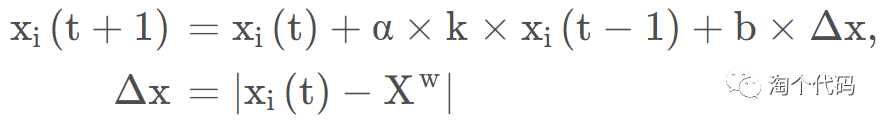

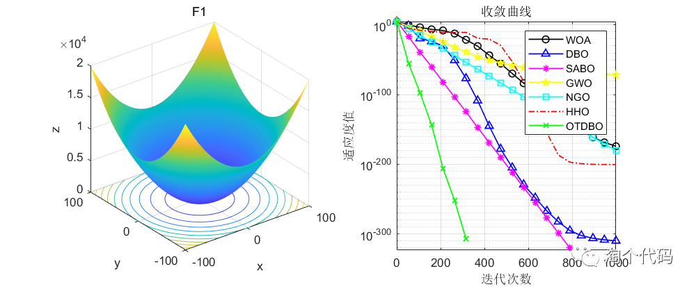
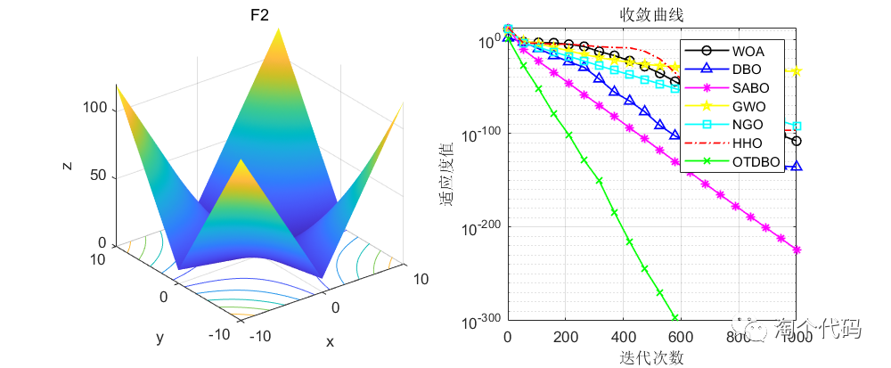
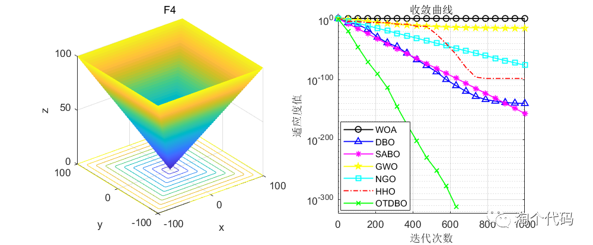
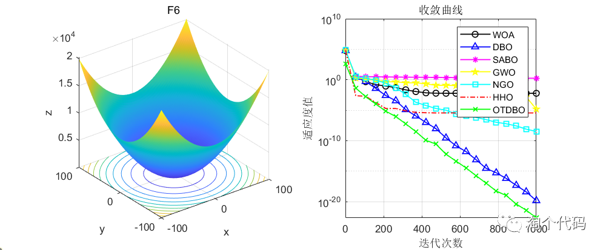
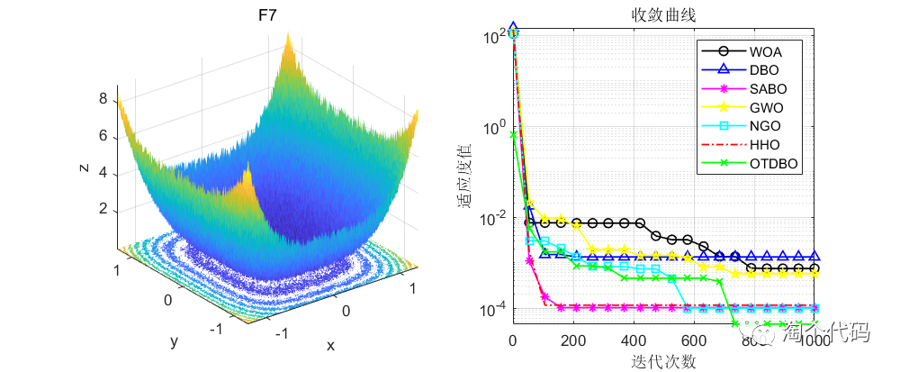
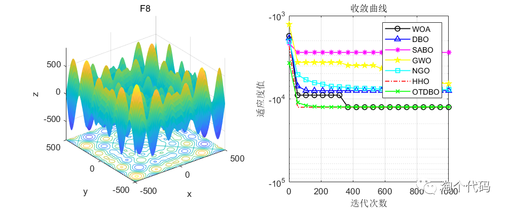
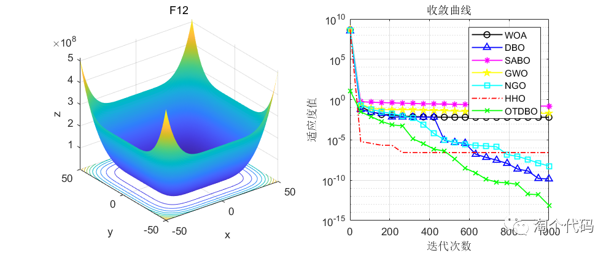
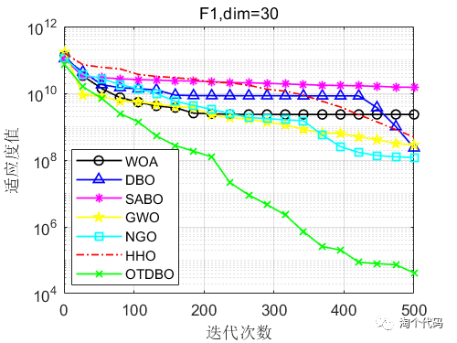
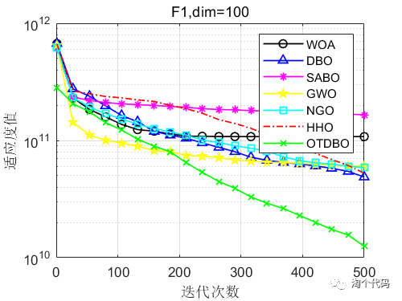
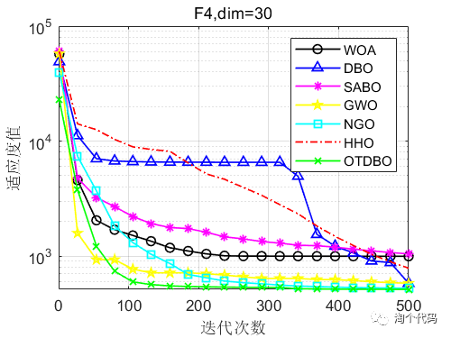
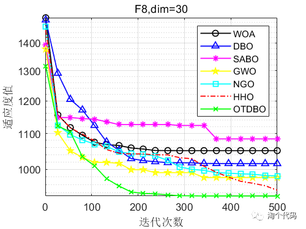
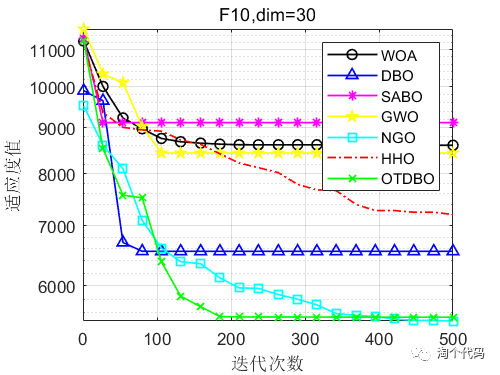
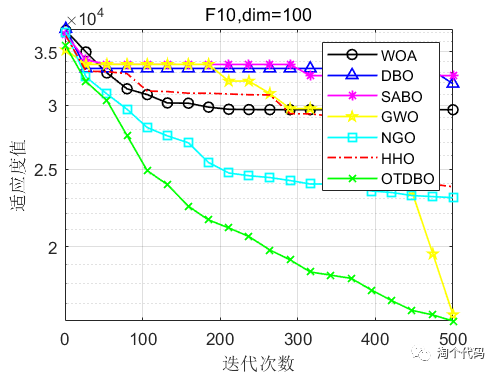
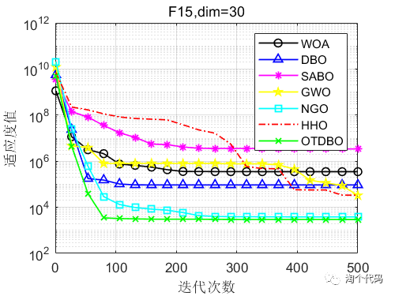
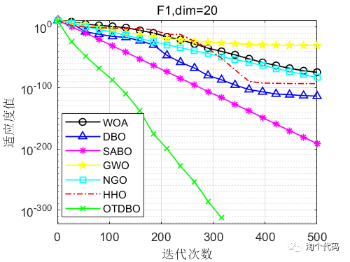
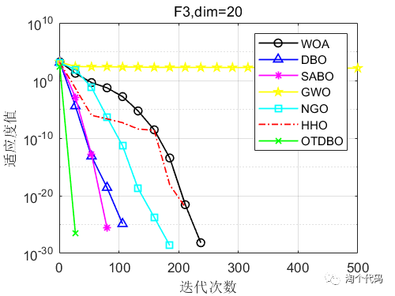
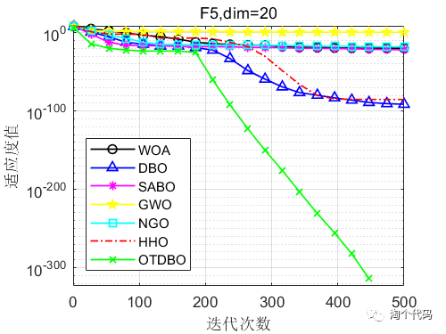
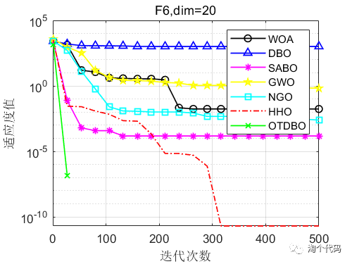
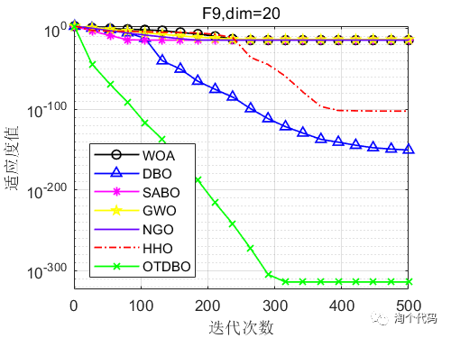
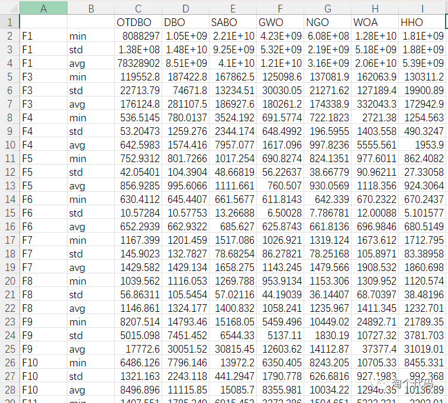
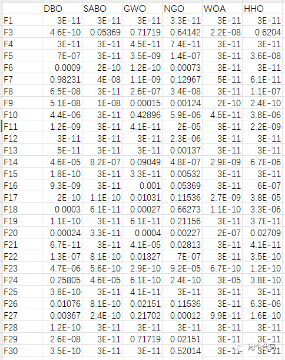
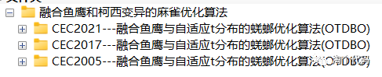
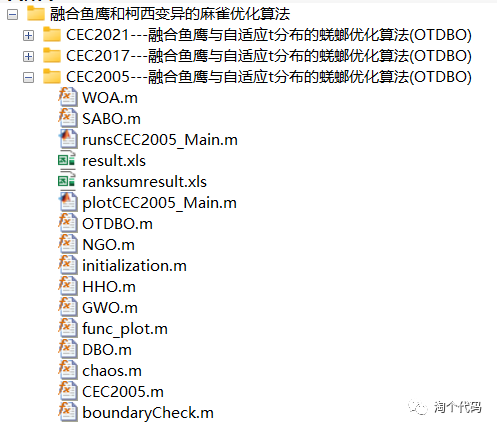
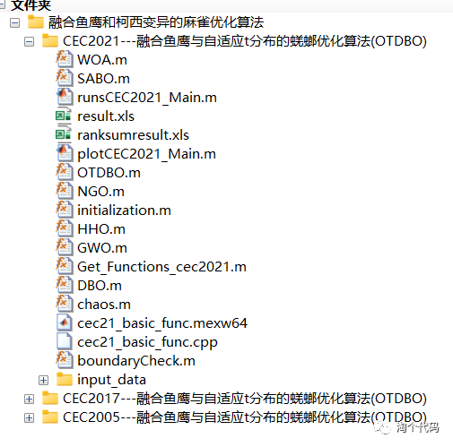
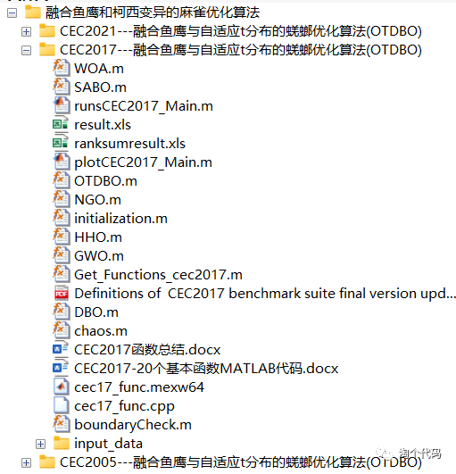

<!-- PAYMENT_BLOCK -->

## Get this dataset

- Payment link (Stripe): [Buy now](https://buy.stripe.com/3cs8yP7sY87d0vu9AB)
- Payment QR code: 

<!-- /PAYMENT_BLOCK -->
